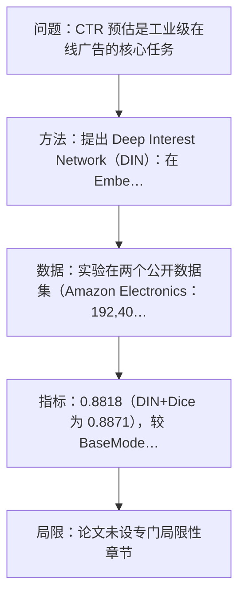

# Deep Interest Network for Click-Through Rate Prediction

> arXiv:[1706.06978](https://arxiv.org/abs/1706.06978) · Guorui Zhou, Chengru Song, Xiaoqiang Zhu, Ying Fan, Han Zhu, Xiao Ma, Yanghui Yan, Junqi Jin, Han Li, Kun Gai · 9 页
> 由 Harness 插件「论文领航」生成于 2026-11-21 16:46，全部引用经 write_note 逐字校验（仅合并空白）

## 结构

## 问题

CTR 预估是工业级在线广告的核心任务。主流深度模型遵循 Embedding&MLP 范式，把用户行为特征池化成一个与候选广告无关的定长向量，难以表达用户多样的兴趣。作者指出这种定长表示是瓶颈，希望让用户兴趣表示随候选广告自适应变化。

**原文依据**

> The use of fixed-length vector will be a bottleneck（来源：摘要）

## 方法

提出 Deep Interest Network（DIN）：在 Embedding&MLP 基础上引入 local activation unit，针对给定候选广告对用户历史行为做软搜索并加权激活，得到随广告变化的用户兴趣表示向量。另提出两项训练技术：mini-batch aware regularization（只对本 mini-batch 出现的特征参数做正则）和数据自适应激活函数 Dice，用于训练数亿参数的工业稀疏网络。

**原文依据**

> Deep Interest Network (DIN) which tackles this challenge by designing a local activation unit to adaptively learn the representation of user interests from historical behaviors with respect to a certain ad（来源：摘要）

> we develop two techniques: mini-batch aware regularization and data adaptive activation function which can help training industrial deep networks with hundreds of millions of parameters（来源：摘要）

> in which only parameters of features appearing in m-th mini-batch participate in the computation of regularization（来源：§6 TRAINING TECHNIQUES，第 5–6 页）

## 数据

实验在两个公开数据集（Amazon Electronics：192,403 用户、63,001 商品、1,689,188 样本；MovieLens：138,493 用户、27,278 电影、20,000,263 样本）和阿里线上展示广告数据（训练集约 20 亿样本、测试集约 1.4 亿）上进行。对手包括 LR、BaseModel、Wide&Deep、PNN、DeepFM，指标为按用户加权平均的 AUC 及 RelaImpr，结果为 5 次重复平均。

**原文依据**

> contains 192,403 users, 63,001 goods,（来源：§7 EXPERIMENTS，第 6–9 页）

> contains 138,493 users,（来源：§7 EXPERIMENTS，第 6–9 页）

> is about 2 billions and 0.14 billion（来源：§7 EXPERIMENTS，第 6–9 页）

## 指标

| 指标 | 数值 | 原文依据（截取） |
| --- | --- | --- |
| DIN AUC（Amazon Electronics） | 0.8818（DIN+Dice 为 0.8871），较 BaseModel RelaImpr +5.35%（Dice 后 +6.82%） | DIN 0.7337 1.61% 0.8818 5.35%（§7 EXPERIMENTS，第 6–9 页） |
| DIN AUC（MovieLens） | 0.7337（DIN+Dice 为 0.7348），较 BaseModel RelaImpr +1.61%（Dice 后 +2.09%） | DIN 0.7337 1.61% 0.8818 5.35%（§7 EXPERIMENTS，第 6–9 页） |
| BaseModel + MBA 正则 AUC（Alibaba） | 0.6031，较无 goods_ids 特征无正则基线 RelaImpr +9.68% | With goods_ids feature and MBA. Reg. 0.6031 9.68%（§7 EXPERIMENTS，第 6–9 页） |

## 局限

论文未设专门局限性章节。作者承认在大规模高维稀疏特征（如 6 亿维 goods_ids）下首个 epoch 后即出现严重过拟合，需依赖所提正则与激活函数技术才能训练，说明方法对工程与正则化策略依赖较强；此外文中未讨论 local activation unit 带来的额外计算在在线服务中的开销分析。

**原文依据**

> overfitting turns to be a big challenge（来源：§7 EXPERIMENTS，第 6–9 页）

> occurs after the first epoch without any regularization（来源：§7 EXPERIMENTS，第 6–9 页）
