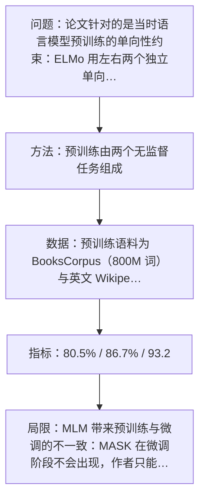

# BERT: Pre-training of Deep Bidirectional Transformers for Language Understanding

> arXiv:[1810.04805](https://arxiv.org/abs/1810.04805) · Jacob Devlin, Ming-Wei Chang, Kenton Lee, Kristina Toutanova · 16 页
> 由 Harness 插件「论文领航」生成于 2026-11-21 13:45，全部引用经 write_note 逐字校验（仅合并空白）

## 结构

## 问题

论文针对的是当时语言模型预训练的单向性约束：ELMo 用左右两个独立单向模型的浅层拼接，GPT 只用从左到右的 Transformer，每个 token 无法在每一层同时融合左右上下文。作者指出这种限制对句子级任务次优，对问答这类 token 级任务尤其有害。BERT 的目标是用掩码语言模型实现深层双向预训练，并让同一个预训练模型只加一个输出层就能适配多种下游任务。

**原文依据**

> Unlike recent language representation models, BERT is designed to pre-train deep bidirectional representations from unlabeled text by jointly conditioning on both left and right context in all layers.

> BERT is conceptually simple and empirically powerful.

## 方法

预训练由两个无监督任务组成。MLM 随机选中 15% 的 WordPiece token 并只预测这些被遮位置：其中 80% 换成 [MASK]、10% 换成随机词、10% 保持原词，以避免 [MASK] 只在预训练出现造成的错配。NSP 以各 50% 的概率判断 B 是 A 的真实下一句（IsNext）还是语料中的随机句（NotNext），用于学习句间关系。输入表示是 token、segment、position 三种 embedding 之和，[CLS] 的最终隐状态作为分类用聚合表示，句对以 [SEP] 分隔；微调时把任务输入输出接入同一 Transformer 端到端训练，仅新增少量参数。

**原文依据**

> In order to train a deep bidirectional representa-

> we simply mask some percentage of the input

> tokens at random, and then predict those masked

> we mask 15% of all WordPiece to-

> next sentence that follows A (labeled as IsNext),

> and 50% of the time it is a random sentence from

## 数据

预训练语料为 BooksCorpus（800M 词）与英文 Wikipedia（2,500M 词），只用 WordPiece 切分、词表 30,000，并刻意保留文档级连续文本而非打散的句子。模型分 BERT_BASE（12 层、768 隐层、12 头，110M 参数）与 BERT_LARGE（24 层、1024 隐层、16 头，340M 参数）两档，前者参数量与 OpenAI GPT 对齐以便对比。微调与评测覆盖 11 个 NLP 任务，GLUE 上使用 batch size 32、训练 3 个 epoch，学习率在 5e-5 至 2e-5 之间按 Dev 集选择。

**原文依据**

> We use WordPiece embeddings (Wu et al.,

> 2016) with a 30,000 token vocabulary. The first

> use the BooksCorpus (800M words) (Zhu et al.,

> 2015) and English Wikipedia (2,500M words).

> We use a batch size of 32 and fine-tune for 3

> (among 5e-5, 4e-5, 3e-5, and 2e-5) on the Dev set.

## 指标

| 指标 | 数值 | 原文依据（截取） |
| --- | --- | --- |
| GLUE score | 80.5% | pushing the GLUE score to 80.5% (7.7% point absolute improvement) |
| MultiNLI accuracy | 86.7% | MultiNLI accuracy to 86.7% (4.6% absolute improvement) |
| SQuAD v1.1 Test F1 | 93.2 | SQuAD v1.1 question answering Test F1 to 93.2 (1.5 point absolute improvement) |
| SQuAD v2.0 Test F1 | 83.1 | SQuAD v2.0 Test F1 to 83.1 (5.1 point absolute improvement) |
| BERT_LARGE GLUE average | 82.1 | BERTLARGE 86.7/85.9 72.1 92.7 94.9 60.5 86.5 89.3 70.1 82.1 |
| Masking rate | 15% | we mask 15% of all WordPiece to- |
| Feature-based gap on CoNLL-2003 | 0.3 F1 | 0.3 F1 behind fine-tuning the entire model |

## 局限

MLM 带来预训练与微调的不一致：[MASK] 在微调阶段不会出现，作者只能用 80% 替换为 [MASK]、10% 随机词、10% 保持原词的策略缓解而无法消除。NSP 训练出的 [CLS] 向量在微调之前并不是有意义的句子表示，它只是借助下游任务才获得聚合语义。此外 BERT_LARGE 在小数据集上微调不稳定，需多次随机重启并挑 Dev 最优模型，说明大模型微调对超参和随机性敏感。

**原文依据**

> are creating a mismatch between pre-training and

> without fine-tuning, since it was trained with NSP.

> was sometimes unstable on small datasets,

> best model on the Dev set. With random restarts,
