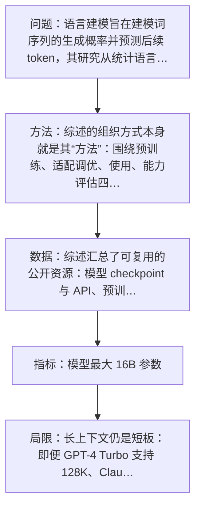

# A Survey of Large Language Models

> arXiv:[2303.18223](https://arxiv.org/abs/2303.18223) · Wayne Xin Zhao, Kun Zhou, Junyi Li, Tianyi Tang, Xiaolei Wang, Yupeng Hou, Yingqian Min, Beichen Zhang, Junjie Zhang, Zican Dong, Yifan Du, Chen Yang, Yushuo Chen, Zhipeng Chen, Jinhao Jiang, Ruiyang Ren, Yifan Li, Xinyu Tang, Zikang Liu, Peiyu Liu, Jian-Yun Nie, Ji-Rong Wen · 144 页
> 由 Harness 插件「论文领航」生成于 2026-11-21 12:28，全部引用经 write_note 逐字校验（仅合并空白）

## 结构

## 问题

语言建模旨在建模词序列的生成概率并预测后续 token，其研究从统计语言模型、神经语言模型一路演进到在大规模语料上预训练的 Transformer。研究者发现参数规模超过一定量级后，模型不仅性能显著提升，还会出现小模型不具备的能力，因此需要一个统一术语和系统梳理来界定“大语言模型”。本综述以参数规模明显偏大（正文以 10B 以上为主）的模型为对象，回顾其背景、关键发现与主流技术。

**原文依据**

> Language is essentially a complex, intricate system of human expressions governed by grammatical rules.

> To discriminate the difference in parameter scale, the research community has coined the term large language models (LLM) for the PLMs of significant size.

> approaches to advancing language intelligence of machines.

## 方法

综述的组织方式本身就是其“方法”：围绕预训练、适配调优、使用、能力评估四个方面建立技术框架，再按此框架归纳代表性模型与做法。预训练部分讨论数据收集与预处理、模型架构、分布式训练与加速；后训练部分讨论指令微调与对齐调优（含 RLHF），并兼顾资源受限下的高效微调与量化；使用部分以提示设计为核心，涵盖上下文学习、思维链与规划。这一框架把分散的文献归入可比较的技术环节，而不是提出新模型或新算法。

**原文依据**

> In particular, we focus on four major aspects of LLMs, namely pre-training, adaptation tuning, utilization, and capacity evaluation.

> After pre-training or adaptation tuning, a major approach

> method is in-context learning [50, 55], which formulates the

## 数据

综述汇总了可复用的公开资源：模型 checkpoint 与 API、预训练语料与训练库，并统计了 Gemma-2、Qwen、LLaMA 等开源系列的参数规模、训练 token 量与算力开销。评测侧按语言生成、知识利用、复杂推理三类基本能力，加上更复杂的高级能力与各类基准来组织已有实证结果。作者同时强调，LLM 的研制与复现门槛很高，因此复用公开资源是现实路径。

**原文依据**

> Besides, we also summarize the available resources for developing LLMs and discuss the remaining issues for future directions.

> It is by no means an easy job to develop or reproduce LLMs,

> surge of tasks and benchmarks have been proposed for

> conducting empirical ability evaluation and analysis. In this

## 指标

| 指标 | 数值 | 原文依据（截取） |
| --- | --- | --- |
| Chinchilla 缩放律拟合的实验规模 | 模型最大 16B 参数；数据 5B–500B tokens | 16B) and data sizes (5B to 500B tokens), and fitted a similar |
| Qwen2.5 预训练 token 量 | 18T tokens | is pre-trained on up to 18T tokens |
| Gemma-2 各尺寸预训练 token 量 | 2T / 8T / 13T tokens（对应 2B/9B/27B） | 2T, 8T, and 13T primarily English tokens, respectively |
| GPT-4 Turbo 上下文窗口 | 128K tokens | Turbo enables a long context of 128K tokens, and Claude |

## 局限

长上下文仍是短板：即便 GPT-4 Turbo 支持 128K、Claude 2.1 支持 200K token，模型仍难以充分利用窗口内信息，且架构探索被 decoder-only Transformer 主导。预训练层面，数据准备与训练流程缺乏可系统复现的细节，对算力和数据质量高度敏感；对齐层面依赖昂贵的人工反馈，幻觉与安全风险依旧突出。作为综述，本文的结论来自对既有文献的归纳，不提供新的实验证据。

**原文依据**

> Turbo enables a long context of 128K tokens, and Claude

> on training LLMs with decoder-only Transformers.

> Model Training. For pre-training, it is essential to establish

> RLHF heavily relies on high-quality human feedback

> exhibit a tendency to generate hallucinations [640]
