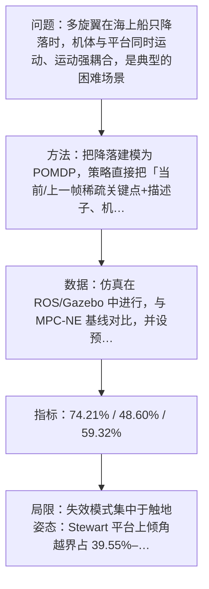

# Vision-Based Agile Landing on Turbulent Waters

> arXiv:[2605.23717](https://arxiv.org/abs/2605.23717) · Dimosthenis Angelis, Leonard Bauersfeld, Davide Scaramuzza, Evangelos Boukas · 8 页
> 由 Harness 插件「论文领航」生成于 2026-11-21 14:04，全部引用经 write_note 逐字校验（仅合并空白）

## 结构

## 问题

多旋翼在海上船只降落时，机体与平台同时运动、运动强耦合，是典型的困难场景；传统做法需要在部署时检测并预测平台运动（如视觉标记或平台状态估计），已有工作依赖显式平台状态。本文目标是只用无人机自身状态与降落面上的局部视觉特征，在部署阶段不做平台状态的显式观测或估计，也能快速完成降落。作者声称这是首个在湍流海况下不依赖显式平台状态的敏捷海上降落方法。

**原文依据**

> Autonomous landing of Unmanned Aerial Vehicles on maritime vessels is challenging due to the coupled motion of the vehicle and landing platform in open-sea conditions.

> This paper presents a reinforcement-learning-based approach for autonomous multirotor landing on moving maritime platforms without requiring explicit platform-state observations or estimation during deployment.

> To the best of our knowledge, this is the first approach for agile multirotor landing on maritime platforms in turbulent waters that does not rely on an explicit platform-state during deployment.

## 方法

把降落建模为 POMDP，策略直接把「当前/上一帧稀疏关键点+描述子、机体状态、上一动作」映射为姿态与推力指令，交给常规底层姿态控制器跟踪，部署时不观测也不估计平台状态。视觉端不用分割掩码或原始 RGB，而是用 SRPose 稀疏关键点编码器，描述子先做 L2 归一化，使匹配先验取决于方向而非幅值。训练时用合成关键点与随机生成的归一化描述子替代真实特征提取器，因此同一策略可零样本对接 SURF、A-KAZE 等不同提取器；策略为高斯 actor-critic（actor/critic 各为两层 512 单元 tanh MLP），在 Aerial Gym 中用 PPO 训练，并配合从静止平台起步的课程学习与 20% 描述子随机丢弃来提升鲁棒性。

**原文依据**

> The proposed method uses multirotor state measurements together with local visual features, consisting of keypoints and associated descriptors extracted from the landing surface, to predict attitude and thrust commands.

> The policy is trained in simulation using synthetic keypoints with randomly generated normalized descriptors, enabling zero-shot deployment with different local feature extractors onboard the UAV.

> The policy is implemented as a Gaussian actor-critic

> we use sparse local features

## 数据

仿真在 ROS/Gazebo 中进行，与 MPC-NE 基线对比，并设预定义 5×5 AprilTag 布局（PD）与随机图案+A-KAZE（RD）两个变体，每种 5 个随机种子、各 500 次降落。真机在搭载 Jetson Orin Nano 的四旋翼上全机载运行（PX4 EKF2 状态估计、PX4 底层控制器、ROS 2 通信），同一策略在 Stewart 平台上切换 A-KAZE 与 SURF 两种特征提取器，共 358 次试验。随后把同一套流程不重训搬到泳池浮台上做 53 次试验，考察人工造浪下的泛化。

**原文依据**

> All methods are evaluated independently over 500 landing trials.

> Stewart platform (AKAZE) 177 39.55 3.39 59.32 97.74 3.50 ± 1.08

> Pool (AKAZE) 53 3.77 7.54 90.57 98.11 2.90 ± 1.56

> Finally, we perform extensive real-world experiments, demonstrating autonomous onboard landing using two different local feature extractors.

## 指标

| 指标 | 数值 | 原文依据（截取） |
| --- | --- | --- |
| Simulation success rate (Ours PD) | 74.21% | Ours (PD) 74.21 ± 3.93 25.79 ± 3.93 5.02 ± 2.28 |
| Simulation success rate (MPC-NE baseline) | 48.60% | MPC-NE 48.60 51.40 9.06 ± 9.14 |
| Real-world touchdown success, Stewart platform (AKAZE) | 59.32% | Stewart platform (AKAZE) 177 39.55 3.39 59.32 97.74 3.50 ± 1.08 |
| Real-world touchdown success, pool (AKAZE) | 90.57% | Pool (AKAZE) 53 3.77 7.54 90.57 98.11 2.90 ± 1.56 |

## 局限

失效模式集中于触地姿态：Stewart 平台上倾角越界占 39.55%–41.44%，触地成功率仅 57%–59%，明显低于泳池浮台的 90.57%，说明平台运动越剧烈越难保证触地姿态。验证仍在受控环境（试验台与人工造浪泳池），训练用的平台运动为正弦叠加模型，与真实海况的不规则动力学存在差距。随机描述子变体成功率 63.08%、掎毁率 36.92%，对特征质量与数量敏感；方法还需平台始终处于下视相机视野内，且未估计平台状态，因此没有显式的安全保证。

**原文依据**

> Stewart platform (SURF) 181 41.44 4.97 57.46 96.13 4.95 ± 7.71

> Ours (RD) 63.08 ± 11.26 36.92 ± 11.26 4.28 ± 1.62
